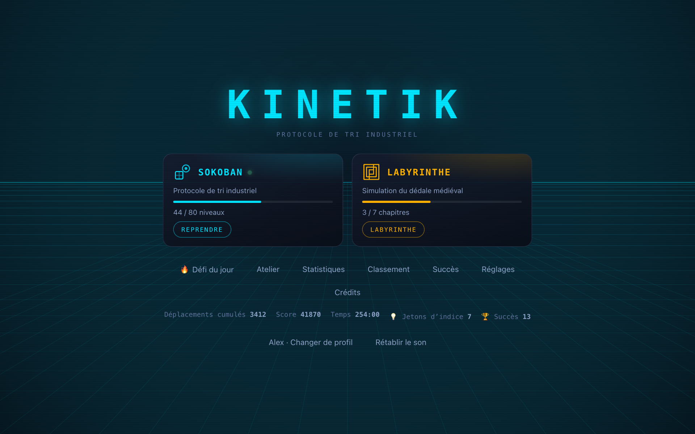
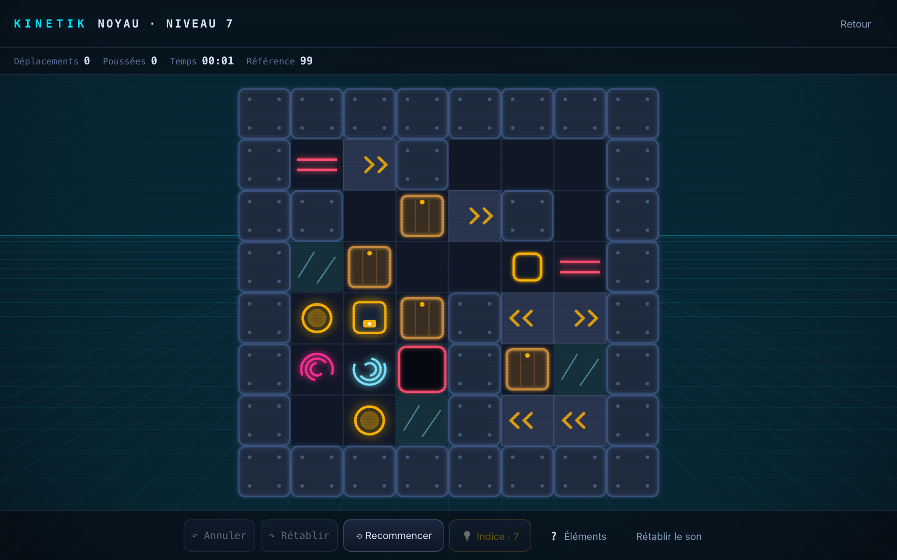
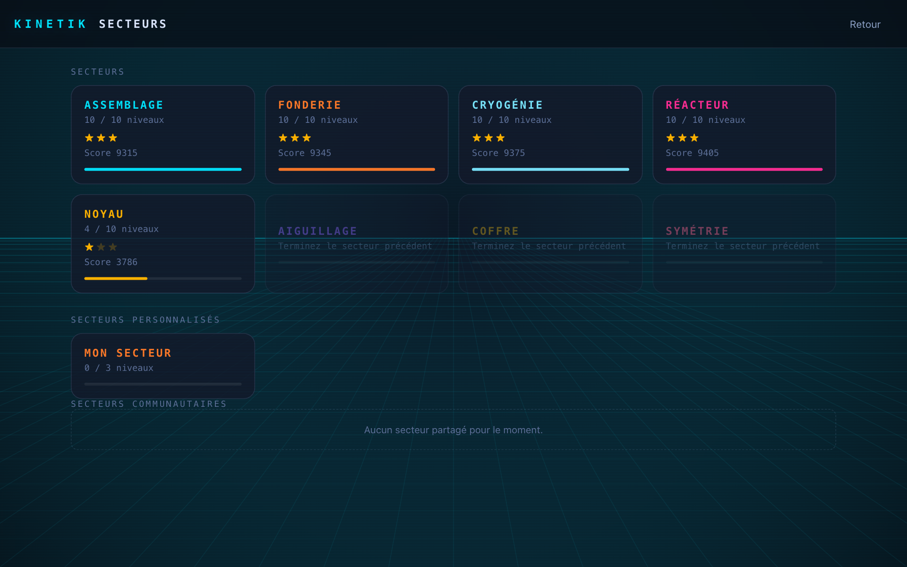
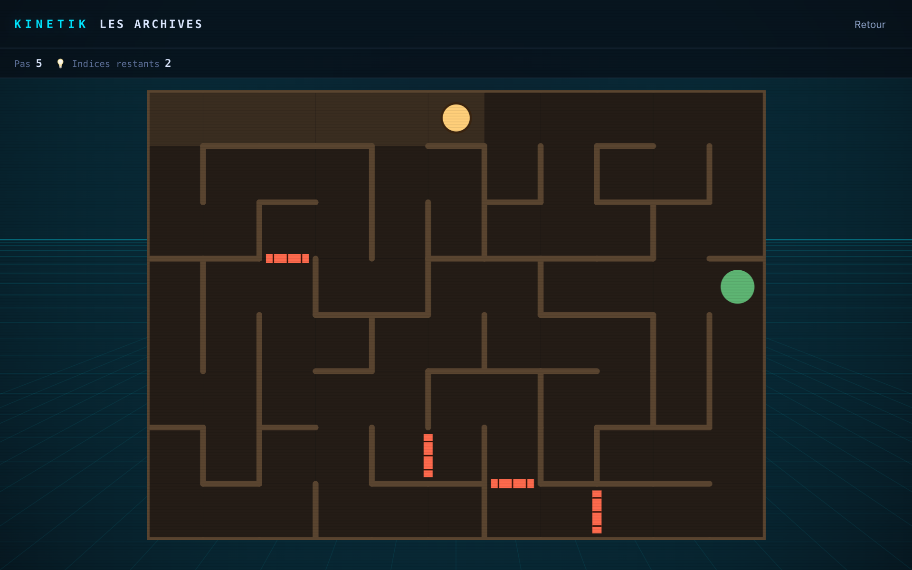
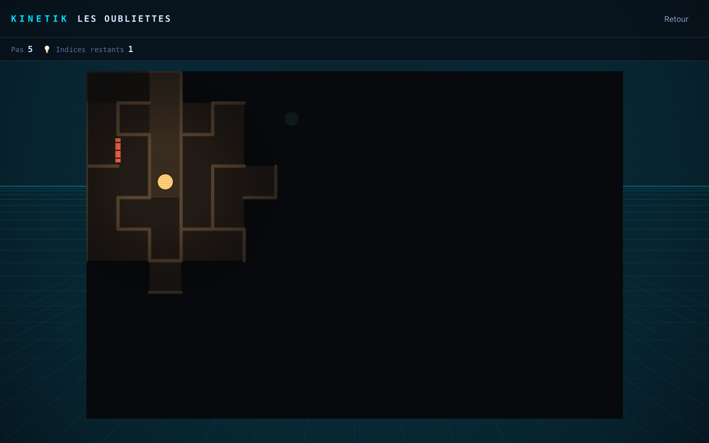
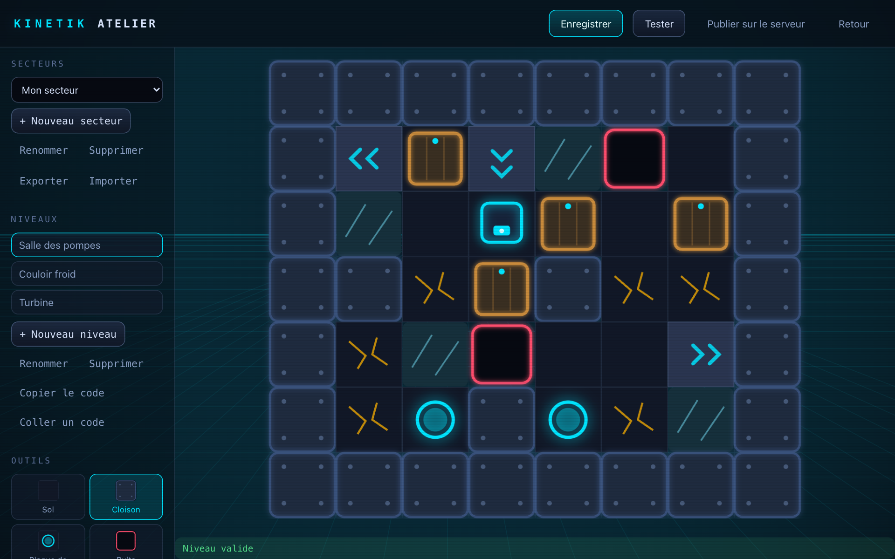
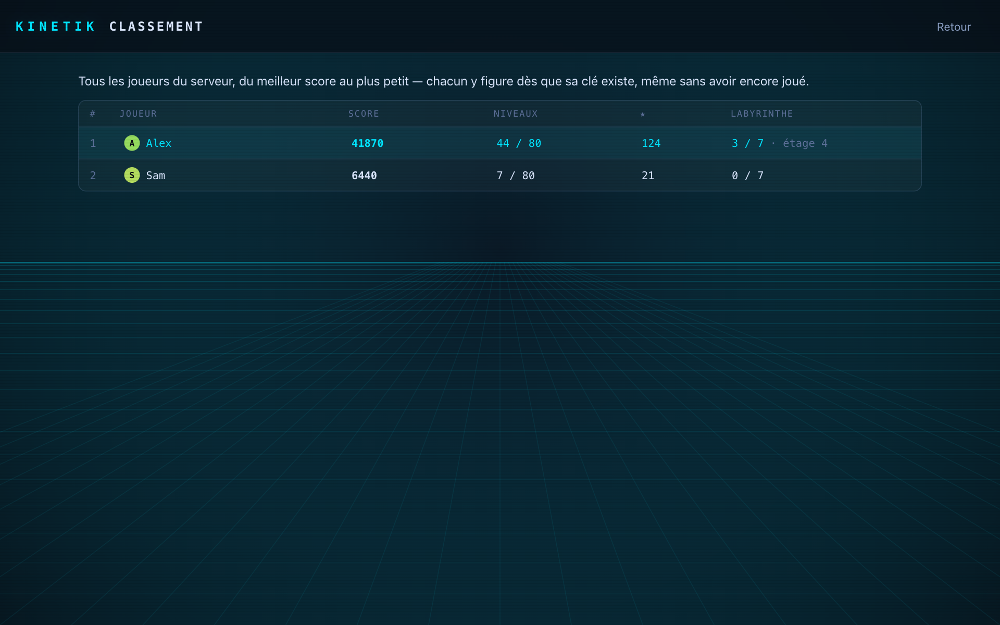
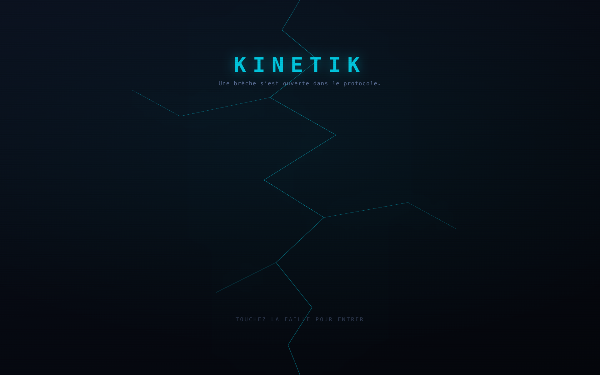
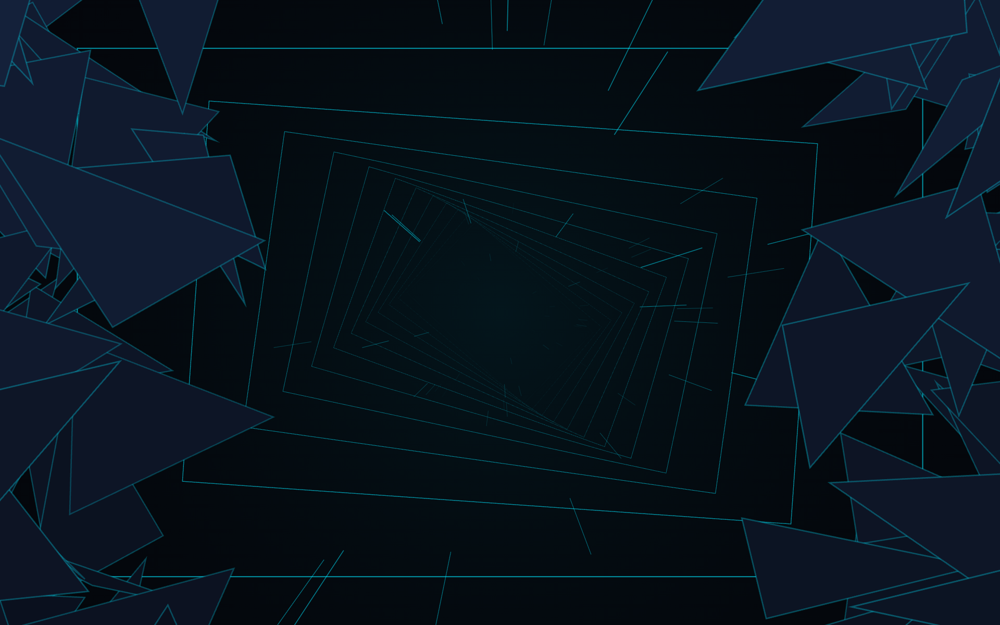

<div align="center">

# KINETIK

**Protocole de tri industriel** : un jeu de puzzle de poussée de conteneurs, doublé
d'un labyrinthe médiéval à énigmes.

[](https://github.com/sdelmart/kinetik/releases/latest)




**[⬇ Télécharger le jeu](https://github.com/sdelmart/kinetik/releases/latest)**

</div>

---

Vous pilotez un drone de manutention dans une usine automatisée : poussez chaque
conteneur sur une plaque de charge. Le drone ne peut que **pousser**, jamais tirer.
**80 niveaux** en huit secteurs, chacun avec sa propre mécanique, un **Labyrinthe**
médiéval où chaque porte cache une énigme, un **Défi du jour**, un **Atelier** pour
créer ses niveaux, et des **classements en ligne** entre amis.

---

## Captures d'écran

| | |
|---|---|
|  |  |
| **Sokoban** : un niveau du Noyau (tapis roulants, glace, téléporteurs, sas) | **Secteurs** : huit secteurs à débloquer, plus les secteurs créés et partagés |
|  |  |
| **Labyrinthe** : chaque grille rouge est une porte verrouillée par une énigme | **Brouillard** : dans les derniers chapitres, seule la torche éclaire |
|  |  |
| **Atelier** : créez vos propres niveaux et secteurs | **Classement** : comparez-vous aux autres joueurs |
|  |  |
| **Écran-titre** : une faille de lumière dans l'écran… | **…qui se brise en éclats** pour plonger dans le jeu |

---

## Télécharger et installer

Rendez-vous sur la **[page des versions](https://github.com/sdelmart/kinetik/releases/latest)**
et choisissez le fichier correspondant à votre ordinateur :

| Système | Fichier |
|---|---|
| macOS, puces Apple (M1, M2, M3, M4) | `KINETIK-x.y.z-macOS-AppleSilicon.dmg` |
| macOS, processeur Intel | `KINETIK-x.y.z-macOS-Intel.dmg` |
| Windows | `KINETIK-x.y.z-Windows-Setup.exe` |
| Linux, toutes distributions | `KINETIK-x.y.z-Linux-x86_64.tar.gz` |
| Linux, fichier unique | `KINETIK-x.y.z-Linux-x86_64.AppImage` |
| Ubuntu, Debian, Mint, Pop!_OS | `KINETIK-x.y.z-Linux-x86_64.deb` |

**macOS** : si macOS indique que l'application est « endommagée », glissez-la dans
Applications puis lancez dans le Terminal :

```bash
xattr -cr /Applications/KINETIK.app
```

**Linux (.tar.gz)** : décompressez l'archive, puis lancez `./kinetik` dans le dossier
obtenu. `./install.sh` l'ajoute au menu des applications.

---

## Le jeu

### Sokoban : 80 niveaux en 8 secteurs

Chaque secteur introduit une nouvelle mécanique et garde celles d'avant. Les niveaux
vont du plus facile au plus difficile.

| Secteur | Nouveauté |
|---|---|
| **Assemblage** | Les bases : pousser, sans jamais se bloquer |
| **Fonderie** | Puits à combler, dalles fragiles qui s'effondrent |
| **Cryogénie** | Glace : tout ce qui y entre glisse jusqu'au prochain obstacle |
| **Réacteur** | Tapis roulants |
| **Noyau** | Téléporteurs, interrupteurs et sas |
| **Aiguillage** | Passages à sens unique |
| **Coffre** | Serrures : un conteneur posé dans la serrure ouvre les portes à clé |
| **Symétrie** | Conteneurs jumeaux, qui bougent en miroir l'un de l'autre |

Terminez les **quatre premiers secteurs** pour débloquer le Labyrinthe.

### Les éléments

| Élément | Effet |
|---|---|
| **Cloison** | Bloque tout. |
| **Plaque de charge** | Le niveau est gagné quand toutes les plaques sont couvertes. |
| **Puits** | Un conteneur poussé dedans le comble et crée un passage. Le drone ne peut pas y entrer. |
| **Dalle fragile** | Cède dès qu'on la quitte, et devient infranchissable. |
| **Glace** | Tout ce qui y arrive glisse jusqu'au prochain obstacle. |
| **Tapis roulant** | Emporte d'une case ce qui s'y trouve. |
| **Téléporteur** | Entrer sur l'un fait ressortir sur l'autre, s'il est libre. |
| **Interrupteur / Sas** | Le sas reste ouvert tant que quelque chose est posé sur l'interrupteur. |
| **Sens unique** | Ne se franchit que dans le sens de la flèche. |
| **Serrure / Porte à clé** | Un conteneur posé dans la serrure y reste et ouvre les portes à clé pour de bon. |
| **Conteneurs jumeaux** | Pousser l'un déplace l'autre dans la direction opposée. |

### Indices

Bloqué ? Un indice (payé avec un jeton) montre le prochain coup d'une solution
optimale, depuis votre position réelle. Les indices se débloquent après avoir
dépassé la référence de 5 coups ou passé 90 secondes sur un niveau. On gagne des
jetons en réussissant des niveaux en 3 étoiles et en terminant des secteurs.

### Le Labyrinthe

Un mode médiéval à part entière : **7 chapitres** et un **mode sans fin**.

- Des labyrinthes toujours différents, de plus en plus grands.
- Un **brouillard** dans les derniers chapitres : seule votre torche éclaire.
- Des **portes à énigmes** : plus de 200 questions de culture générale (histoire,
  sciences, géographie, arts, logique) et des énigmes de logique et de calcul qui
  se renouvellent sans fin.
- Une mauvaise réponse change l'énigme et coûte 5 pas.
- Des **passages secrets** cachés dans les murs.
- Un niveau de culture générale réglable.

### Défi du jour

Un nouveau niveau chaque jour, le même pour tout le monde. Enchaînez les jours
réussis pour faire grimper votre série 🔥.

### Atelier

Créez vos propres niveaux et secteurs, testez-les, exportez-les, partagez un niveau
sous forme de code à coller dans un message, ou publiez-le pour les autres joueurs.

### En ligne, entre amis

Avec l'adresse d'un serveur KINETIK et votre clé (dans **Réglages**) :

- jouez les **secteurs créés** par les autres joueurs ;
- comparez-vous dans les **classements** par niveau, par secteur et général ;
- retrouvez votre **progression** sur tous vos ordinateurs.

### Et aussi

- **Profils** : jusqu'à 6 joueurs sur le même ordinateur.
- **23 succès** à débloquer et un écran de **statistiques**.
- **Musique** originale (5 morceaux et un mode aléatoire).
- **Personnalisation** : touches, couleur d'interface, fonds animés, mode daltonien…
- **Manette** et **écran tactile** pris en charge.
- **4 langues** : français, anglais, allemand, espagnol.

### Score

Partez de 1000 points : chaque coup au-delà de la référence coûte 8 points, chaque
seconde 2 points (400 au maximum), avec un minimum de 100. Tenez la référence pour
obtenir 3 étoiles.

---

## Commandes

| Touche | Action |
|---|---|
| Flèches / WASD | Déplacer |
| `Z` | Annuler |
| `Y` | Rétablir |
| `R` | Recommencer le niveau |
| `Échap` | Retour |

Toutes les touches sont modifiables dans les Réglages.
